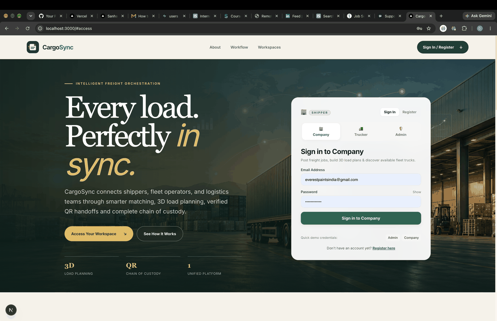
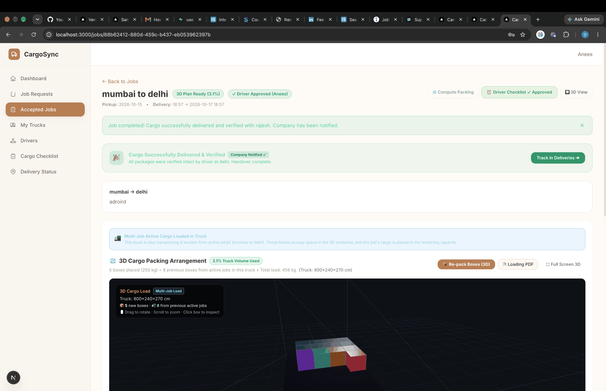
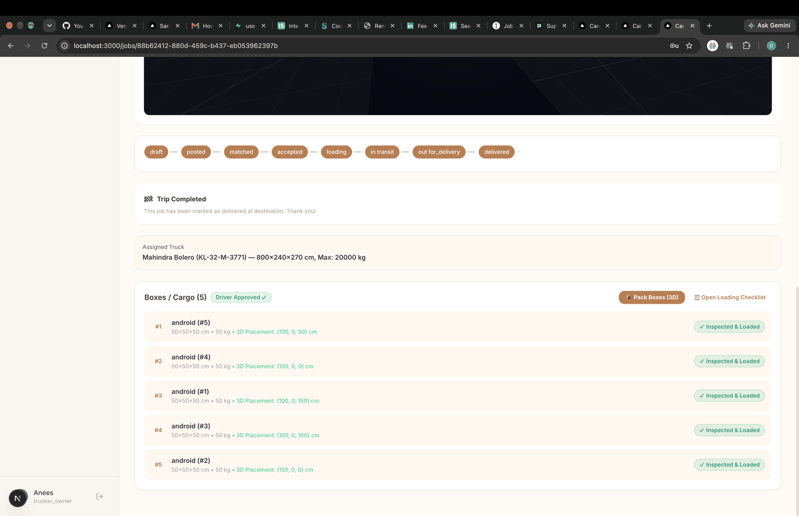

# CargoSync

<p align="center">
  <strong>Smart Logistics. Optimized Loading. Reliable Deliveries.</strong>
</p>

CargoSync is a full-stack freight and fleet management platform designed to help logistics teams plan shipments, manage vehicles and drivers, optimize cargo loading, and verify deliveries through a centralized digital system.

The platform combines intelligent 3D cargo optimization, fleet tracking, shipment workflow management, and checklist-based verification to improve operational efficiency, reduce manual coordination, and provide better visibility across the delivery lifecycle.

---

## Visual Previews

<p align="center">
  
  <br/>
  <em>Intelligent Freight Orchestration Landing Page & Multi-Role Access</em>
</p>

<p align="center">
  
  <br/>
  <em>Interactive 3D Container Bin-Packing & Spatial Cargo Orientation</em>
</p>

<p align="center">
  
  <br/>
  <em>Digital Custody Verification & Pre-Departure Checklist</em>
</p>

---

## Overview

CargoSync supports the complete freight management process from shipment creation to loading, execution, and final delivery. It gives shippers, dispatch teams, and fleet operators a unified workflow for managing jobs, cargo, trucks, drivers, and delivery checkpoints.

## Key Features

### 3D Cargo Optimization
- Uses 3D bin-packing logic to determine efficient cargo placement inside trucks
- Maximizes available vehicle space and improves loading efficiency
- Evaluates box dimensions, weight constraints, and loading sequence
- Provides an interactive 3D truck loading arrangement for better spatial planning

### Fleet and Vehicle Management
- Manage truck records, dimensions, and capacity details
- Maintain driver profiles, licenses, and assignments
- Match transportation requirements with suitable fleet assets
- Track fleet readiness and operational usage

### Shipment and Job Management
- Create and monitor freight jobs from start to completion
- Manage cargo dimensions, weights, destinations, and delivery information
- Track shipment status throughout the workflow (`draft` → `posted` → `matched` → `accepted` → `loading` → `in_transit` → `out_for_delivery` → `delivered`)
- Organize job records in a central platform

### Checklist-Based Loading and Delivery Verification
- Use digital checklists to validate cargo during loading and unloading
- Record completed and pending verification steps
- Monitor delivery progress and eliminate discrepancies
- Improve chain-of-custody accountability across handovers

### Multi-Stop Delivery Support
- Handle jobs with multiple destinations and stop sequences
- Organize cargo according to delivery order
- Support reverse sequencing for more efficient unloading at destination points

### Authentication and Role-Based Access
- Secure user logins with JWT-based authentication
- Separate Super Admin, Shipper Company, and Fleet Carrier access
- Protected dashboard routes and API endpoints
- Password hashing with bcrypt

### Digital Loading Documentation
- Generate shipment loading sheets for operational reference
- Provide structured cargo placement coordinates
- Support smoother coordination between dispatch and field teams

---

## Technology Stack

| Layer | Technologies |
|---|---|
| Frontend | Next.js 16 (App Router), React 19, TypeScript, Tailwind CSS |
| 3D Visualization | Three.js, React Three Fiber, React Three Drei |
| Backend | Python, FastAPI |
| Database | Supabase PostgreSQL (with SQLite local fallback) |
| ORM / Validation | SQLAlchemy, Pydantic v2 |
| Authentication | JWT, Python-JOSE, bcrypt |
| API Communication | REST API, Axios |
| Document Generation | ReportLab |

---

## System Architecture

CargoSync follows a full-stack architecture with a Next.js frontend, a FastAPI backend, and a PostgreSQL database hosted on Supabase.

```text
             ┌──────────────────────────┐
             │         FRONTEND         │
             │ Next.js 16 + React 19    │
             │ TypeScript + Tailwind    │
             │      Three.js UI         │
             └────────────┬─────────────┘
                          │
                    REST API / HTTP
                          │
             ┌────────────▼─────────────┐
             │         BACKEND          │
             │      FastAPI + Python    │
             │   SQLAlchemy + JWT       │
             │   Cargo Optimization     │
             └────────────┬─────────────┘
                          │
                     SQL Queries
                          │
             ┌────────────▼─────────────┐
             │         DATABASE         │
             │     Supabase PostgreSQL   │
             │ Users, Trucks, Drivers   │
             │ Jobs, Cargo, Deliveries │
             │ Claims, Audit Logs       │
             └──────────────────────────┘
```

---

## Project Structure

```text
CargoSync/
├── frontend/                  # Next.js frontend application
│   ├── src/                   # React components, pages, and hooks
│   ├── public/                # Static assets
│   ├── .env.example           # Frontend environment template
│   └── package.json
├── backend/                   # FastAPI backend service
│   ├── app/                   # API routes, models, schemas, core logic
│   ├── alembic/               # Database migrations and version scripts
│   ├── seed.py                # Database seed script with demo records
│   ├── .env.example           # Backend environment template
│   └── requirements.txt       # Pinned backend dependencies
├── database/                  # Database DDL schema, tables & data dictionary
├── diagrams/                  # Formal UML & ER diagrams (SVG and PNG)
├── screenshots/               # Optimized UI application screenshots
├── PROJECT_SUMMARY.md         # Detailed project summary
├── LICENSE                    # MIT License
├── .gitignore                 # Git ignore rules
└── README.md
```

---

## Environment Variables

CargoSync uses environment variables for configuration. Example templates with placeholder values are provided:
- **Backend:** [`backend/.env.example`](backend/.env.example)
- **Frontend:** [`frontend/.env.example`](frontend/.env.example)

Copy these templates to set up your environment:
```bash
# Backend
cp backend/.env.example backend/.env

# Frontend
cp frontend/.env.example frontend/.env.local
```

---

## Getting Started

### Prerequisites
- Node.js 20 or above
- Python 3.11 or above
- npm
- Git

### Backend Setup

```bash
cd backend

# Create and activate virtual environment
python -m venv venv
source venv/bin/activate       # On Windows: venv\Scripts\activate

# Install dependencies
pip install -r requirements.txt

# Run migrations (or use SQLite local fallback)
alembic upgrade head

# (Optional) Seed demo accounts and sample cargo
python seed.py

# Start development server
uvicorn app.main:app --reload --port 8000
```

The API endpoints will be accessible at:
- **API root:** http://localhost:8000
- **Swagger docs:** http://localhost:8000/docs
- **ReDoc alternative:** http://localhost:8000/redoc

### Frontend Setup

```bash
cd frontend

# Install dependencies
npm install

# Start Next.js dev server
npm run dev
```

The application interface will be live at:
- http://localhost:3000

---

## Demo Credentials

You can populate demo data using `python seed.py` or use pre-configured test logins:

| Role | Email | Password |
|---|---|---|
| **Super Admin** | `admin@cargosync.com` | `Admin123!` |
| **Shipper** | `shipper@cargosync.com` | `Shipper123!` |
| **Fleet Carrier** | `carrier@cargosync.com` | `Carrier123!` |
| **Demo Shipper** | `abc@gmail.com` | `Password123!` |

The login page also includes quick-fill buttons for instant demo sign-in.

---

## Security

CargoSync incorporates several security practices:
- **JWT Authentication:** Cryptographically signed tokens with expiration handling
- **Password Protection:** Cryptographic password hashing using bcrypt via passlib
- **Role-Based Access Control:** Distinct authorization boundaries for Super Admins, Shippers, and Carriers
- **Protected Routes:** Context-aware routing and auth guards on frontend and backend
- **Input Validation:** Strict schema enforcement using Pydantic v2
- **ORM-based Queries:** Parameterized SQL queries via SQLAlchemy to prevent SQL injection
- **CORS Guarding:** Whitelisted origin filtering

---

## Contributors

Developed as an MCA Final Semester Project.

- **Dharvesh Ahamed**
- **Farhad Shihab Yaseen**

## Project Information

- **Project Name:** CargoSync
- **Category:** Full-Stack Web Application
- **Domain:** Logistics & Fleet Management
- **Repository:** https://github.com/DharveshAhamed/CargoSync

## License

This project is licensed under the [MIT License](LICENSE).
